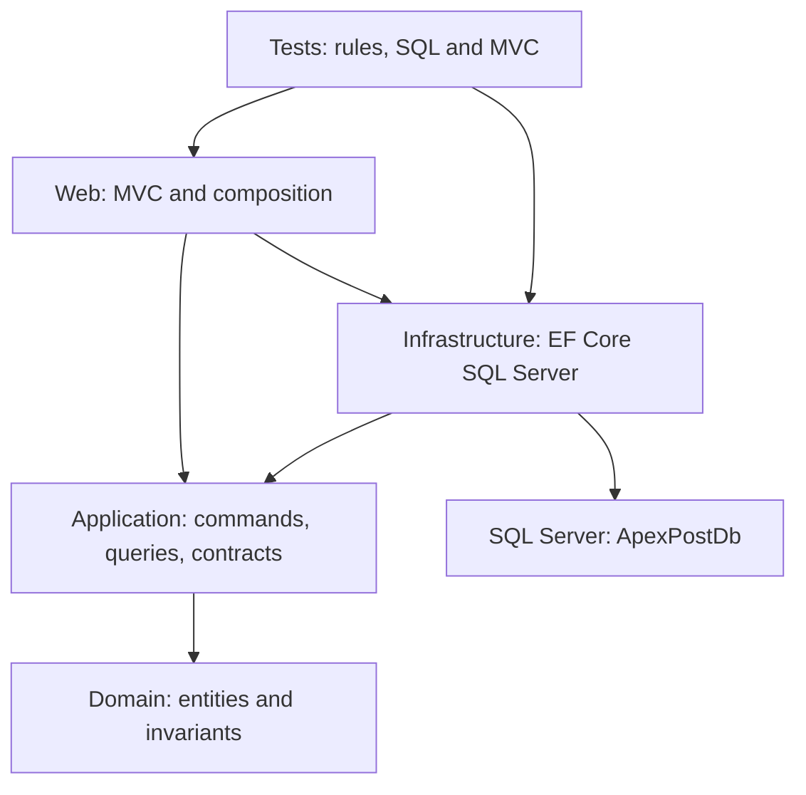
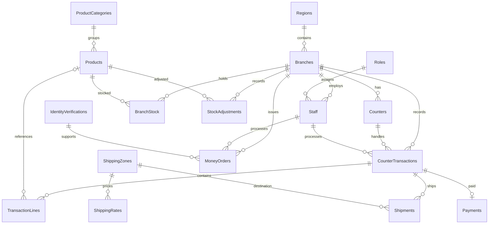

# ApexPost — Week 3 design

The application retains five primary projects. Domain references no application/framework project. Application owns contracts and use-case rules. Infrastructure implements SQL mapping/repositories/query services; Web is the composition root. An optional evidence console references Infrastructure to reproduce measurements.

## Relational model

There are 18 principal tables: the 17 named in Parts A–H plus Regions for region revenue reporting. Owned Address, OpeningHours and optional staff IdentityDocument share their owner's table; Money amount/currency values are flattened without JSON serialization.

AuditEntries is deliberately independent of business foreign keys: staff/branch identifiers are snapshots so failed/unknown requests can be audited without invalid FK dependencies. A separate context commits sanitized audit data after final response status is known. Audit failures are logged and do not reverse a committed sale. This is best-effort audit, not guaranteed durable delivery.

## Normalization and constraints

1. Branch/region data is separate from transactions: changing a branch address/region does not rewrite every sale (update anomaly).
2. Product category/role lookups are separate: a new category/role exists without inserting a fake product/staff row (insertion anomaly).
3. Transaction header, lines and payments are separate: deleting a draft line cannot remove the branch/staff identity of its transaction (deletion anomaly).

PKs identify rows. Branch code, product SKU, staff email, branch+counter number and branch+product stock are unique. Transaction counter+branch uses a composite FK to prevent mismatched counters. Historical references use NO ACTION; transaction lines cascade with their parent aggregate. Product deletion is additionally guarded against stock/history in the command service. CHECK constraints enforce quantities, weights, amounts, line type/product consistency, statuses and masked identity shape. DEFAULT constraints on all principal tables populate UTC creation time and actor, with nullable modification time. SQL Server rowversion protects stock and transactions. Money columns are decimal(18,2); weights decimal(18,3); UTC timestamps datetime2; codes varchar and names nvarchar.

## Command and query boundaries

Repositories stage changes only, return no IQueryable, and share one scoped ApexPostDbContext with scoped EfUnitOfWork. A command commits once. Checkout validates first, then stages stock, transaction changes and one Payment; one SaveChanges transaction rolls back all of them on failure. Parent transaction modification is explicitly touched when a line changes so its rowversion also protects line-vs-payment races. No application-wide payment semaphore remains.

Views read DTOs from AsNoTracking projections and SQL aggregates. Reports execute four queries regardless of branch count; a command-count integration test enforces this. Query services compose/await sequentially on the scoped context. The transaction aggregate has one collection, so Include on its tracked command load does not create multiple-collection cartesian explosion; no unnecessary AsSplitQuery is added. There is **one database**, not separate query/command databases.

IdentityVerification has a separate persistence record and explicit mapper. Its masked identifier/fingerprint can be restored without reconstructing a raw number. Other core aggregates map directly using private constructors/backing fields, complex Money and owned types. Scalar converters handle Sku/BranchCode/Weight; the PHP-only tariff Money converter rejects other currencies rather than silently discarding them.

## Preserved business decisions

- Branch/staff/counter ownership, inactive staff, opening hours, positive quantities and manager correction rules remain domain behavior.
- High-value money orders (>=10000 in platform currency) remain disabled without an independent verifier. Fingerprint recording/confirmation is not proof of independent verification.
- Void/refund eligibility is unchanged. A correction does not automatically restock merchandise: a separate reasoned stock adjustment records returned inventory. This avoids assuming every financial correction returns goods.
- Historical seed data is generated from valid relations; corrupt old JSON is not silently imported.
- Optional raw identity inputs exist only while binding/creating a masked domain object. They are never persisted/logged and are cleared before form redisplay.

## SOLID mapping

| Principle | Implementation |
|---|---|
| SRP | Domain validates; application coordinates use cases; EF maps/stages; query services project; MVC binds/renders. |
| OCP | Application contracts permit a different data adapter without moving business rules into Web. |
| LSP | EF and fake repositories preserve contract semantics; SQL tests verify staged writes and real state round trips. |
| ISP | Specific stock, payment, shipment, audit and query contracts avoid an IQueryable-based universal repository. |
| DIP | Domain/Application do not reference EF or SqlClient; Infrastructure translates persistence conflicts to application exceptions. |

## Security and operations

Cookie authentication and branch/role claims remain; server-authorized route IDs and command lookups choose targets. Request DTOs cannot bind status/audit identity. Framework errors stay 500; domain errors 400, missing resources 404, unique/concurrency conflicts 409, with Problem Details. Local Bootstrap/scripts comply with restrictive CSP. EF command logging uses normal Microsoft.EntityFrameworkCore.Database.Command logging without sensitive data enabled. Configure its Development level in appsettings.Development.json.

Transient retries are not enabled by default; the explicit transaction wrapper invokes the configured provider execution strategy. Enabling retry-on-failure later requires fresh attempt state and unknown-commit reconciliation, not blind replay of stock or external effects. Payment identity is unique per transaction to reject double payment.

Offline/outbox topics are listed in the assignment taxonomy but have no Parts A–H acceptance criteria. No second/offline database or listener subsystem is added. Trainer clarification is needed before expanding that scope.

See docs/adr/0007–0014 and PERFORMANCE.md for evidence-linked decisions.
